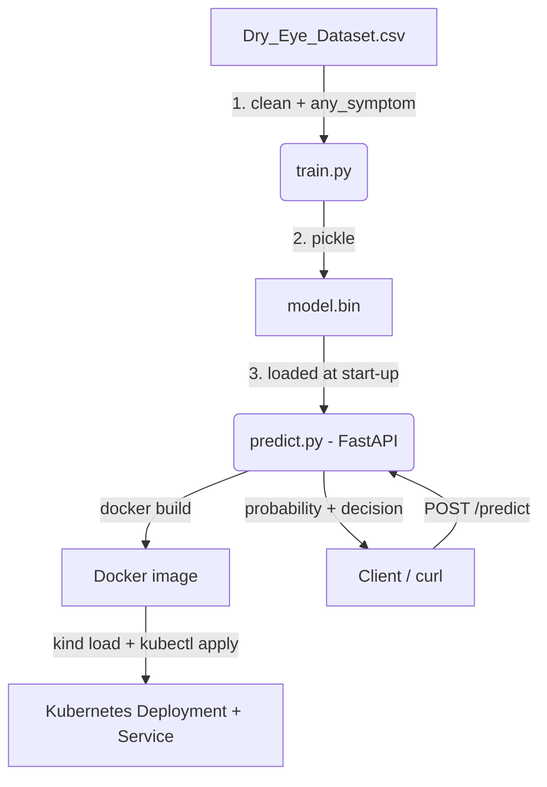
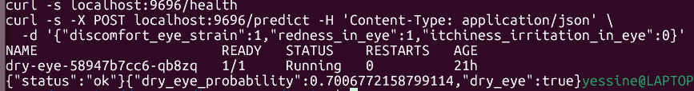

# Dry Eye Disease Screening Model

A small machine learning service that estimates the probability that a person has dry eye disease
from three self-reported eye symptoms. Midterm project for the
[DataTalks.Club Machine Learning Zoomcamp 2026](https://github.com/DataTalksClub/machine-learning-zoomcamp).

> **Disclaimer:** this is a course project, not a medical device. The model is a weak screening
> signal, not a diagnosis.

**Contents**
[Problem statement](#problem-statement) ·
[Dataset](#dataset-description) ·
[EDA and findings](#eda-and-key-findings) ·
[Modeling](#modeling-approach-and-metrics) ·
[Architecture](#architecture) ·
[How to run](#how-to-run) ·
[Limitations](#known-limitations-and-next-steps)

## Problem statement

Dry eye disease (DED) is a common eye condition. Many people only see an eye specialist once the
symptoms are serious. A short questionnaire could tell people early whether an eye exam is worth booking.

The objective of this project is to build a binary classifier that, given yes/no answers about
eye symptoms, returns the probability that the person has dry eye disease, and to serve it as a web
service.

- **Target:** `Dry Eye Disease` (`1` = has dry eye disease, `0` = does not).
- **Features used by the final model:** `Discomfort Eye-strain`, `Redness in eye`, `Itchiness/Irritation in eye`.
- **Who benefits:** clinics and health apps that want a quick pre-screening step, and people deciding
  whether to see a specialist.
- **Metric:** **ROC AUC** (primary). 65% of the people in the data have the disease, so accuracy would be
  misleading: answering "yes" every time already gives 65%.

## Dataset description

Source: Kaggle, [Dry Eye Disease](https://www.kaggle.com/datasets/dakshnagra/dry-eye-disease)
(20,000 rows, 26 columns, ages 18 to 45). Check the license on the Kaggle page.
The CSV is **not committed** to this repository, so download it first (see [Get the data](#2-get-the-data)).

| Group | Columns | Observed values |
| --- | --- | --- |
| Demographics | `Gender`, `Age`, `Height`, `Weight` | F/M; age 18 to 45; height 150 to 200; weight 50 to 100 |
| Sleep and stress | `Sleep duration`, `Sleep quality`, `Stress level`, `Sleep disorder`, `Wake up during night`, `Feel sleepy during day` | hours 4 to 10; scores 1 to 5; Y/N |
| Health | `Blood pressure`, `Heart rate`, `Daily steps`, `Physical activity`, `Medical issue`, `Ongoing medication` | text like `137/89`; 60 to 100; 1,000 to 20,000; 0 to 180; Y/N |
| Habits | `Caffeine consumption`, `Alcohol consumption`, `Smoking` | Y/N |
| Screen use | `Smart device before bed`, `Average screen time`, `Blue-light filter` | Y/N; hours 1 to 10; Y/N |
| **Symptoms** | `Discomfort Eye-strain`, `Redness in eye`, `Itchiness/Irritation in eye` | Y/N |
| **Target** | `Dry Eye Disease` | Y/N |

### Data preparation

- Column names are lowercased and spaces, `-` and `/` are replaced by `_`.
- `Blood pressure` (`137/89`) is split into numeric `systolic` and `diastolic` columns.
- All Y/N columns, including the target, are converted to `1`/`0`.
- No missing values, no duplicate rows and no impossible values were found.

### Validation framework

The data is split once with `random_state=1`:

| Part | Share | Use |
| --- | ---: | --- |
| Train | 60% | fit models |
| Validation | 20% | compare models |
| Test | 20% | final check, used once |

Model comparison uses 5-fold cross-validation on train + validation.

## EDA and key findings

The full analysis is in [`notebook.ipynb`](notebook.ipynb).

- **Class balance:** 65.2% have the disease, 34.8% do not.
- **Synthetic-looking data:** almost every column is spread evenly between round limits, and every
  Y/N column is about 50/50. Real survey data is rarely like this.
- **Feature importance:** only the three symptoms stand out.
  - Correlation with the target is 0.10 to 0.11 for the symptoms and 0.02 or below for every other feature.
  - Mutual information agrees: about 0.005 to 0.006 for the symptoms, about 0.0001 or less for the rest.
- **Symptoms drive the signal:** the disease rate is about **30% with no symptom** and about **67% to 72%
  with at least one symptom**, almost regardless of which one.
- **Lifestyle features carry no signal:** sleep, stress, screen time, caffeine and similar features
  give an AUC of about 0.5 (chance level) with every model tried.

## Modeling approach and metrics

Four model families were tuned on three feature sets using 5-fold cross-validation ROC AUC:

| Model | Tuned parameters (grid) |
| --- | --- |
| Logistic regression | `C` in 0.01, 0.1, 1, 10 (scaled inputs) |
| Decision tree | `max_depth` in 2, 3, 4, 6; `min_samples_leaf` in 10, 50, 100 |
| Random forest | `n_estimators` in 100, 200; `max_depth` in 3, 5, 8; `min_samples_leaf` in 10, 50 |
| XGBoost | `eta` in 0.03, 0.1; `max_depth` in 2, 3, 4; `n_estimators` in 100, 200 |

Best cross-validation ROC AUC of each model after tuning (fold standard deviation is about 0.015):

| Features | Logistic regression | Decision tree | Random forest | XGBoost |
| --- | ---: | ---: | ---: | ---: |
| All features | 0.601 | 0.596 | 0.601 | 0.600 |
| Symptoms only | 0.598 | 0.592 | 0.593 | 0.599 |
| Lifestyle only (no symptoms) | 0.500 | 0.507 | 0.503 | 0.503 |

**Model choice:** all model families tie within noise, and adding the lifestyle features does not help.
The simplest model was selected for deployment:

- **Logistic regression on a single feature, `any_symptom`** (1 if at least one of the three symptoms
  is present). This matches the pattern in the data: the symptoms act as a group, not one by one.
- Trained on train + validation, evaluated once on the test set: **test ROC AUC = 0.589**.
- With `any_symptom = 0` the service returns about 0.31, with `any_symptom = 1` about 0.70.

## Architecture

### Project folder structure

```
.
├── notebook.ipynb         # cleaning, EDA, feature importance, model comparison and tuning
├── train.py               # trains the final model and writes model.bin
├── predict.py             # FastAPI service (/health, /predict)
├── download_data.py       # optional Kaggle download helper
├── model.bin              # trained model (committed)
├── Dockerfile             # container image of the service
├── k8s/                   # Kubernetes deployment and service
├── docs/deployment.png    # screenshot of the service running on Kubernetes
├── data/                  # put Dry_Eye_Dataset.csv here (not committed)
└── pyproject.toml, uv.lock, .python-version   # dependencies and Python version
```

### Architecture diagram



## How to run

Requirements: **Git**, **Python 3.12** and [uv](https://docs.astral.sh/uv/). Docker is needed for the
container steps, and `kind` plus `kubectl` for the Kubernetes step.

### 1. Clone the repository

```bash
git clone https://github.com/Y-Naifer/dry-eye-disease-prediction.git
cd dry-eye-disease-prediction
```

### 2. Get the data

The dataset is not stored in the repository. Choose one option:

- **Manual (recommended):** download the zip from the
  [Kaggle page](https://www.kaggle.com/datasets/dakshnagra/dry-eye-disease), unzip it, and make sure the
  file is at `data/Dry_Eye_Dataset.csv`:
  ```bash
  mkdir -p data
  # then copy Dry_Eye_Dataset.csv into data/
  ```
- **Script (needs a Kaggle API token in `~/.kaggle/access_token`):**
  ```bash
  uv run python download_data.py
  ```

### 3. Install dependencies and activate the environment

Install uv if you don't have it (`curl -LsSf https://astral.sh/uv/install.sh | sh` or `pip install uv`), then:

```bash
uv sync                     # creates .venv and installs the locked dependencies
source .venv/bin/activate   # activate the virtual environment (Windows: .venv\Scripts\activate)
```

After activating, you can run `python ...` directly. Without activating, prefix commands with `uv run`.

### 4. Open the notebook (optional)

```bash
jupyter notebook            # or: uv run jupyter notebook
```

Open `notebook.ipynb` and use the project's `.venv` as the kernel. Run it from the project root so the
path `data/Dry_Eye_Dataset.csv` resolves. The model grid takes a few minutes.

### 5. Train the model

```bash
python train.py
# test ROC AUC: 0.589
# saved model.bin
```

This overwrites `model.bin`, which the service and the Docker image use.

### 6. Run the web service locally

```bash
uvicorn predict:app --host 0.0.0.0 --port 9696
```

Interactive API docs are at http://localhost:9696/docs.

Test it from a second terminal:

```bash
curl -s localhost:9696/health
# {"status":"ok"}

curl -s -X POST localhost:9696/predict -H 'Content-Type: application/json' \
  -d '{"discomfort_eye_strain":1,"redness_in_eye":1,"itchiness_irritation_in_eye":0}'
# {"dry_eye_probability":0.70...,"dry_eye":true}

curl -s -X POST localhost:9696/predict -H 'Content-Type: application/json' \
  -d '{"discomfort_eye_strain":0,"redness_in_eye":0,"itchiness_irritation_in_eye":0}'
# {"dry_eye_probability":0.31...,"dry_eye":false}
```

Inputs must be `0` or `1`. Unknown fields or other values are rejected with HTTP 422.
Stop the server with `Ctrl+C`.

### 7. Run with Docker

```bash
docker build -t dry-eye-prediction .
docker run -it --rm -p 9696:9696 dry-eye-prediction
```

Then use the same `curl` commands as above. Stop the container with `Ctrl+C`.

### 8. Deploy to Kubernetes (local kind cluster)

```bash
kind create cluster --name dry-eye                       # or reuse an existing kind cluster
kind load docker-image dry-eye-prediction:latest --name dry-eye
kubectl apply -f k8s/
kubectl rollout status deployment/dry-eye
kubectl get pods                                         # STATUS should be Running
kubectl port-forward service/dry-eye 9696:80
```

Use the same `curl` commands as above in a second terminal. If you reuse an existing cluster, replace
`dry-eye` in the `kind load` command with that cluster's name (`kind get clusters`).
To remove the app: `kubectl delete -f k8s/`.

Working deployment (pod `Running` and a prediction returned):



## Known limitations and next steps

- **Weak signal:** the best ROC AUC is about 0.6, so the service separates people only slightly better
  than chance. It should not be used for medical decisions.
- **Lifestyle features add nothing** in this dataset, so a screening tool based on sleep, stress or screen
  time is not supported by this data.
- **Synthetic-looking data:** the uniform ranges and exact 50/50 columns suggest generated data, and the
  sample covers ages 18 to 45 only. Results may not transfer to real patients.
- **Next steps:** validate on a real clinical dataset, collect further clinical indicators (for example
  tear-film tests), and use a calibrated threshold chosen with clinicians.
